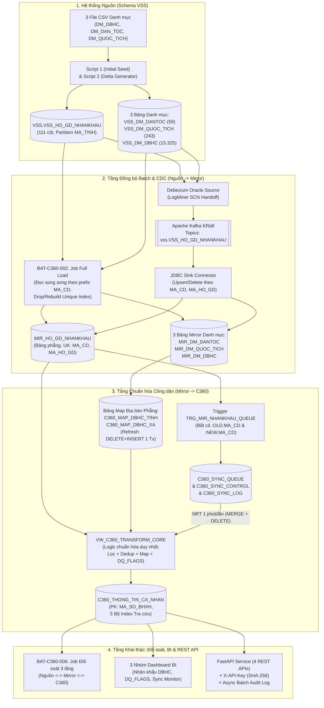

# Thiết kế cơ bản (Basic Design)

> Hệ thống Đồng bộ Dữ liệu Hộ gia đình - Nhân khẩu, Chuẩn hóa Công dân (Customer 360), Báo cáo BI & Cổng Dịch vụ API Tra cứu (`HDG -> Mirror -> C360 -> BI & API`)
> Tài liệu chuẩn cho repo và đối soát kỹ thuật. Đồng bộ 100% với file `design/ThietKeCoBan_BasicDesign_HGD_C360.xlsx`.

## HuongDan – Hướng dẫn sử dụng

**Mục đích của Basic Design (BD)**
- Trả lời câu hỏi: Hệ thống LÀM GÌ, nhìn từ phía người dùng, hệ thống tích hợp ngoài và vận hành dữ liệu. Chưa đi sâu vào giải thuật dòng lệnh bên trong (đó là việc của Detail Design).
- Người đọc: PO / Nghiệp vụ BHXH, Solution Architect, Tech Lead, Kỹ sư Dữ liệu (DE), Kỹ sư Backend và Kiểm thử viên (QA/Tester).

**Quy ước định danh thống nhất**
- Mọi đối tượng đều có ID duy nhất:
  - `F-C360-xxx`: Chức năng nghiệp vụ & luồng dữ liệu
  - `SCR-C360-xxx`: Màn hình Dashboard BI / Giám sát
  - `API-C360-xxx`: Giao tiếp RESTful API tra cứu C360
  - `BAT-C360-xxx`: Tác vụ xử lý dữ liệu (Data Generator, Full Load, CDC, Chuẩn hóa C360, Đối soát)
  - `TBL-C360-xxx`: Bảng dữ liệu vật lý (Nguồn `VSS`, Vùng `MIRROR`, Vùng chuẩn hóa `C360` & Mart/Control)
  - `MSG-Exxx / Ixxx`: Mã thông báo lỗi / thông tin
- Detail Design và Unit Test bắt buộc tham chiếu lại các ID này để đảm bảo khả năng truy vết (Traceability).

**Quy mô dữ liệu & Bối cảnh đặc thù**
- Hệ thống nguồn `VSS.VSS_HO_GD_NHANKHAU` trên Production có `~138 triệu` bản ghi (111 cột, `PARTITION BY RANGE (MA_TINH)`), cùng 3 bảng danh mục: `VSS_DM_DANTOC` (`59` dòng), `VSS_DM_QUOC_TICH` (`243` dòng), `VSS_DM_DBHC` (`15.325` dòng, gồm `36` đơn vị cấp Tỉnh và `3.322` đơn vị cấp Xã/Phường/Đặc khu đang hiệu lực sau sáp nhập hành chính 01/07/2025, bỏ cấp Huyện).
- Một công dân (`MA_CD`) có thể xuất hiện ở nhiều hộ gia đình (`MA_HO_GD`), khóa duy nhất ở nguồn và Mirror là cặp **`(MA_CD, MA_HO_GD)`**, trong khi bảng đích `C360_THONG_TIN_CA_NHAN` chỉ giữ **duy nhất 1 dòng mới nhất còn hiệu lực** cho mỗi `MA_CD`.

---

## Bia – Bìa tài liệu

| Mục | Nội dung |
| --- | --- |
| Tên dự án | Xây dựng Pipeline Dữ liệu Hộ gia đình - Nhân khẩu (HDG -> C360 -> BI & API) |
| Hệ thống | Phân hệ Đồng bộ CDC, Chuẩn hóa Dữ liệu Công dân (Customer 360), Báo cáo BI & Dịch vụ API |
| Tài liệu | Thiết kế cơ bản (Basic Design) |
| Mã tài liệu | C360-BD-001 |
| Phiên bản | 1.0 |
| Người lập | Nhóm Kỹ sư Dữ liệu & Hệ thống |
| Người review | Tech Lead / Solution Architect |
| Người phê duyệt | Ban Quản lý Thu & Trung tâm CNTT (BHXH Việt Nam) |
| Ngày phê duyệt | 2026/11/10 |
| Trạng thái | Approved |
| Tài liệu đầu vào | Yêu cầu `Yeucau_DataPipeline_HGD_C360_4Tuan.md`; Bộ 3 file CSV danh mục thực tế (`DM_DBHC_202611091512.csv`, `DM_DAN_TOC_202611091513.csv`, `DM_QUOC_TICH_202611091512.csv`) |

---

## LichSu – Lịch sử sửa đổi

| Phiên bản | Ngày | Sheet / Mục thay đổi | Nội dung thay đổi | Lý do | Người sửa | Người duyệt |
| --- | --- | --- | --- | --- | --- | --- |
| 1.0 | 2026/11/10 | Toàn bộ | Khởi tạo tài liệu Thiết kế cơ bản toàn trình cho Pipeline HDG -> Mirror -> C360 -> Đối soát, BI & 4 REST APIs; phản ánh kết quả khảo sát bộ 3 file CSV danh mục thực tế vào thiết kế bảng Map và Sheet QA | Thực hiện Tuần 1 theo kế hoạch 4 tuần | Nhóm Kỹ sư | Tech Lead |

---

## TongQuan – Tổng quan hệ thống

| Mục | Nội dung |
| --- | --- |
| Mục đích | Xây dựng một Data Pipeline hoàn chỉnh từ đầu đến cuối (End-to-End): Đồng bộ dữ liệu từ hệ thống Hộ gia đình - Nhân khẩu (`VSS`) theo cả hai phương thức Full Load (JDBC song song) và CDC thời gian thực (Kafka + Debezium) về vùng `Mirror`; chuẩn hóa, khử trùng, ánh xạ địa bàn hành chính 2 cấp (Tỉnh - Xã sau sáp nhập 2025) và gắn cờ chất lượng dữ liệu (`DQ_FLAGS`) vào bảng `C360_THONG_TIN_CA_NHAN` (hỗ trợ cả Full Load và cập nhật Near Real-time 1 phút/lần qua Queue); cung cấp hệ thống Đối soát 3 tầng, 3 nhóm Dashboard BI và 4 RESTful APIs tra cứu tốc độ cao. |
| Phạm vi | 1. `F-C360-001`: Sinh dữ liệu giả lập ban đầu (Initial Seed) và giả lập biến động (`INSERT`/`UPDATE`/`DELETE`/đổi `MA_CD`) bám sát dữ liệu thực tế. 2. `F-C360-002`: Đồng bộ Full Load và CDC (Debezium Source -> Kafka -> JDBC Sink) từ Nguồn `VSS` sang vùng `Mirror`. 3. `F-C360-003`: Tiền xử lý bảng Map địa bàn hành chính 2 cấp (`C360_MAP_DBHC_TINH`, `C360_MAP_DBHC_XA`) và chuẩn hóa dữ liệu công dân `C360_THONG_TIN_CA_NHAN` (dùng chung 1 nguồn logic cho cả Full Load & Near Real-time Queue). 4. `F-C360-004`: Đối soát dữ liệu tự động 3 tầng (Nguồn <-> Mirror <-> C360) và kiểm toán cờ lỗi `DQ_FLAGS`. 5. `F-C360-005`: Hệ thống 3 nhóm Dashboard BI (Nhân khẩu theo địa bàn mới, Chất lượng dữ liệu `DQ_FLAGS`, Giám sát vận hành Near Real-time Sync). 6. `F-C360-006`: Dịch vụ 4 RESTful APIs tra cứu C360 (Theo mã đơn lẻ ưu tiên 3 tầng, Theo lô 1.000 mã, Tìm kiếm Họ tên + Ngày sinh, Lấy danh sách bản ghi thay đổi theo Cursor) kèm xác thực `X-API-Key` SHA-256 và Async Batch Audit Log. |
| Ngoài phạm vi | 1. Can thiệp sửa trực tiếp dữ liệu gốc trên phần mềm nghiệp vụ Hộ gia đình (HDG). 2. Xử lý nghiệp vụ thanh quyết toán chi phí KCB BHYT. |
| Tác nhân | 1. `ACT-01`: Cán bộ nghiệp vụ / Lãnh đạo (khai thác 3 nhóm Dashboard BI và báo cáo chất lượng dữ liệu). 2. `ACT-02`: Các hệ thống phần mềm nội bộ ngành BHXH (gọi 4 RESTful APIs tra cứu C360 qua `X-API-Key`). 3. `ACT-03`: Kỹ sư vận hành Data / Hệ thống lập lịch Airflow (vận hành pipeline Full Load, CDC, Near Real-time Queue và Job Đối soát). |
| Sơ đồ ngữ cảnh | DB Nguồn (`Oracle VSS`) -> `Spark/Python Full Load` & `Debezium Kafka CDC` -> Vùng `Mirror` -> `Trigger Queue` + `Core Standardization View/Procedure` -> Bảng đích `C360_THONG_TIN_CA_NHAN` -> `Job Đối soát 3 tầng` + `Metabase/Superset BI` + `FastAPI REST Service (4 APIs + Async Audit)`. |
| Công nghệ | DB: Oracle Database 23ai Free (hoặc Dual-Engine SQLite/DuckDB cho local test RAM thấp); Streaming CDC: Apache Kafka 3.8 (KRaft), Debezium Connect 2.7; Batch/ETL: Python 3.12+, PySpark / Oracledb, PL/SQL Package & Trigger; Orchestration: Apache Airflow 2.10; BI: Metabase / Apache Superset; API: FastAPI, Pydantic v2, Uvicorn. |
| Giả định / ràng buộc | 1. Khóa vật lý xác định 1 bản ghi ở bảng nguồn và Mirror là cặp `(MA_CD, MA_HO_GD)`. 2. Bảng đích C360 có khóa chính là `MA_SO_BHXH` (lấy từ `MA_CD`), mỗi công dân đang hiệu lực chỉ có duy nhất 1 dòng. 3. Bản ghi bị loại khỏi C360 khi `NVL(TYPEID, 'ZZ') IN ('GT','GM','GG','GK')` hoặc `NVL(TRANG_THAI_DUYET, 0) IN (1,3,4)`. 4. Mọi dữ liệu lỗi định dạng (tỉnh/xã không map, xã mơ hồ, tỉnh lệch xã, ngày sinh lỗi, SĐT lỗi, thiếu CCCD 12 số, dân tộc/quốc tịch lỗi) đều không bị loại bỏ mà vẫn giữ trên C360 kèm mã lỗi nối trong cột `DQ_FLAGS`. |
| Thuật ngữ | `HDG`: Hệ thống Hộ gia đình - Nhân khẩu. `C360`: Customer 360 (Bảng thông tin cá nhân chuẩn hóa duy nhất). `CDC`: Change Data Capture (Bắt dữ liệu thay đổi qua Redo Log/LogMiner). `DBHC 2025`: Địa bàn hành chính 2 cấp sau sáp nhập 01/07/2025 (36 đơn vị cấp Tỉnh, 3.322 đơn vị cấp Xã, bỏ cấp Huyện). `HIEN_HANH / SAP_NHAP / MO_HO`: 3 mức ưu tiên ánh xạ địa bàn hành chính từ cột `MA_DBHC` và `MA_DBHC_SN`. `DQ_FLAGS`: Cột lưu danh sách cờ chất lượng dữ liệu ngăn cách bởi dấu `;`. |

### Kiến trúc tổng thể hệ thống (Architecture Diagram)

---

## DSChucNang – Danh sách chức năng

| ID chức năng | Tên chức năng | Loại | Tác nhân | Mô tả tóm tắt | Màn hình / API / Batch liên quan | Ưu tiên | Nguồn yêu cầu | Ghi chú |
| --- | --- | --- | --- | --- | --- | --- | --- | --- |
| F-C360-001 | Giả lập dữ liệu nguồn & Biến động CDC | Batch / Tool | ACT-03 | Nạp 3 file CSV danh mục thực tế; sinh dữ liệu nhân khẩu ban đầu (Script 1) có cài cắm đầy đủ các trường hợp dữ liệu bẩn; đẩy biến động `INSERT`/`UPDATE`/`DELETE`/đổi `MA_CD` (Script 2). | BAT-C360-001 | Cao | Phần 1 - Mục 1 | Bao phủ 100% ca biên |
| F-C360-002 | Đồng bộ Full Load & CDC về vùng Mirror | Batch / Streaming | ACT-03 | Nạp toàn bộ 4 bảng nguồn sang Mirror (chia partition đọc song song theo `MA_CD`, không OOM) và đồng bộ biến động liên tục qua Kafka + Debezium theo khóa `(MA_CD, MA_HO_GD)`. | BAT-C360-002, BAT-C360-003 | Cao | Phần 1 - Mục 2, 3 | Chuyển giao SCN không mất/trùng dòng |
| F-C360-003 | Tiền xử lý Map DBHC 2 cấp & Chuẩn hóa C360 | Batch / Near Real-time | ACT-03 | Tách phẳng `MA_DBHC_SN` ra 2 bảng Map Tỉnh/Xã (`DELETE + INSERT` trong 1 transaction); lọc nghiệp vụ, khử trùng theo `MA_CD`, chuẩn hóa 3 địa chỉ/ngày sinh/CCCD/SĐT/dân tộc/quốc tịch, gắn cờ `DQ_FLAGS`; chạy cả Full Load và Near Real-time mỗi phút qua Queue. | BAT-C360-004, BAT-C360-005 | Cao | Phần 2 - Mục 1..5 | Dùng chung 1 View/SQL logic duy nhất |
| F-C360-004 | Đối soát dữ liệu 3 tầng & Kiểm toán chất lượng | Batch | ACT-03 | Đối soát số lượng Nguồn <-> Mirror (tổng & theo tỉnh); đối soát `COUNT(DISTINCT MA_CD)` hợp lệ ở Mirror khớp 100% với `COUNT(*)` ở C360; kiểm tra mẫu nhiều hộ, kiểm tra bản ghi đã xóa và thống kê `DQ_FLAGS`. | BAT-C360-006 | Cao | Phần 3 - Mục 1 | Chứng minh sai lệch = 0 |
| F-C360-005 | Dashboard BI Phân tích & Giám sát | Online (BI) | ACT-01, ACT-03 | Cung cấp 3 nhóm biểu đồ: (1) Thống kê nhân khẩu & tỷ lệ CCCD 12 số theo Tỉnh/Xã mới; (2) Báo cáo chất lượng dữ liệu `DQ_FLAGS` theo địa phương; (3) Giám sát vận hành lô đồng bộ Near Real-time. | SCR-C360-001, SCR-C360-002, SCR-C360-003 | Cao | Phần 3 - Mục 2 | Kết nối Metabase / Superset |
| F-C360-006 | Dịch vụ REST API Tra cứu C360 & Audit Log | Online (API) | ACT-02 | Cung cấp 4 API: Tra cứu cá nhân đơn lẻ (dò 3 tầng ưu tiên), Tra cứu theo lô (tối đa 1.000 mã), Tìm kiếm theo Họ tên + Ngày sinh, và Lấy danh sách thay đổi theo Cursor (`SYNC_DATE`, `ID`); xác thực `X-API-Key` SHA-256 và ghi Async Batch Audit Log. | API-C360-001 -> API-C360-004 | Cao | Phần 3 - Mục 3 | Không quét full bảng |

---

## DSManHinh – Danh sách màn hình & chuyển màn hình

| ID màn hình | Tên màn hình | ID chức năng | Mô tả | Từ màn hình | Sự kiện chuyển | Đến màn hình | Quyền truy cập |
| --- | --- | --- | --- | --- | --- | --- | --- |
| SCR-C360-001 | Dashboard Nhóm 1: Thống kê Nhân khẩu & Định danh theo Địa bàn | F-C360-005 | Biểu đồ phân bổ số lượng công dân theo 36 Tỉnh/TP và 3.322 Xã/Phường mới (sau sáp nhập 2025), nhóm độ tuổi, giới tính, tình trạng `IS_ALIVE` và tỷ lệ phủ Số định danh/CCCD 12 số hợp lệ. | Trang chủ BI | Chọn Tab 'Nhân khẩu & Định danh' | SCR-C360-002 | ROLE_BI_VIEWER, ROLE_ADMIN |
| SCR-C360-002 | Dashboard Nhóm 2: Báo cáo Chất lượng Dữ liệu (Data Quality) | F-C360-005 | Biểu đồ số lượng & tỷ lệ % bản ghi sạch vs mắc từng cờ lỗi trong `DQ_FLAGS` (`TINH_KHONG_MAP`, `XA_KHONG_MAP`, `XA_MO_HO`, `TINH_LECH_XA`, `NGAY_SINH_LOI`, `SDT_LOI`, `KHONG_SO_DINH_DANH`...) và so sánh tỷ lệ lỗi giữa các Tỉnh/TP. | Trang chủ BI / SCR-C360-001 | Chọn Tab 'Chất lượng dữ liệu' | SCR-C360-003 | ROLE_BI_VIEWER, ROLE_DATA_STEWARD |
| SCR-C360-003 | Dashboard Nhóm 3: Giám sát Vận hành Đồng bộ (Sync Monitoring) | F-C360-005 | Biểu đồ chuỗi thời gian theo dõi các lô chạy Near Real-time mỗi phút: số khóa `MA_CD` biến động, số dòng `MERGE`, số dòng `DELETE`, thời gian xử lý (`DURATION_MS`), trạng thái đối soát 3 tầng và cảnh báo lỗi. | Trang chủ BI / SCR-C360-002 | Chọn Tab 'Giám sát vận hành' | — | ROLE_DATA_ENGINEER, ROLE_ADMIN |

---

## DinhNghiaManHinh – Định nghĩa hạng mục màn hình

| Màn hình | No | Tên hạng mục | Loại control | I/O | Bắt buộc | Kiểu / Độ dài | Định dạng | Giá trị mặc định | Kiểm tra | Nguồn dữ liệu | Ghi chú |
| --- | --- | --- | --- | --- | --- | --- | --- | --- | --- | --- | --- |
| SCR-C360-001 | 1 | Bộ lọc Tỉnh/Thành phố mới | Dropdown | I | × | Chuỗi / 3 | Mã tỉnh 3 số (`001`..`098`) | Tất cả | Thuộc 36 tỉnh mới | `VW_BI_NHANKHAU_DBHC` | Lọc theo `MA_TINH_THUONG_TRU` |
| SCR-C360-001 | 2 | KPI Tổng công dân hợp lệ & Tỷ lệ có CCCD 12 số | KPI Card | O | — | Số nguyên / % | `#,##0` / `0.00%` | — | — | `VW_BI_NHANKHAU_DBHC` | Tổng hợp toàn quốc / theo tỉnh |
| SCR-C360-001 | 3 | Biểu đồ Công dân theo Tỉnh/TP & Tình trạng sống (`IS_ALIVE`) | Stacked Bar | O | — | Biểu đồ cột | — | — | Sắp xếp giảm dần theo dân số | `VW_BI_NHANKHAU_DBHC` | Phân tách Còn sống (`1`) / Đã mất (`0`) |
| SCR-C360-001 | 4 | Biểu đồ Tháp tuổi & Giới tính | Pyramid / Bar | O | — | Biểu đồ | Nhóm tuổi: `<18`, `18-35`, `36-60`, `>60` | — | — | `VW_BI_NHANKHAU_DBHC` | Tính từ năm sinh chuẩn hóa |
| SCR-C360-001 | 5 | Biểu đồ Tỷ lệ có CCCD 12 số vs Chưa có (CMND 9 số/Trống) theo Tỉnh | 100% Stacked Bar | O | — | Biểu đồ | Tỷ lệ % | — | — | `VW_BI_NHANKHAU_DBHC` | Đánh giá tiến độ định danh BCA |
| SCR-C360-002 | 1 | KPI Tỷ lệ Bản ghi Sạch hoàn toàn (`DQ_FLAGS IS NULL`) | KPI Card | O | — | Số nguyên / % | `#,##0` / `0.00%` | — | — | `VW_BI_DATA_QUALITY` | Đo lường sức khỏe dữ liệu tổng thể |
| SCR-C360-002 | 2 | Biểu đồ Số lượng & Tỷ lệ % từng loại lỗi `DQ_FLAGS` | Horizontal Bar | O | — | Biểu đồ | 11 mã lỗi chuẩn | — | Một bản ghi có thể mắc nhiều lỗi | `VW_BI_DQ_FLAG_BREAKDOWN` | Tách chuỗi `DQ_FLAGS` theo dấu `;` |
| SCR-C360-002 | 3 | Bảng & Biểu đồ Xếp hạng Tỉnh/TP theo tỷ lệ dữ liệu bẩn | Bar / Grid | O | — | Danh sách | 36 Tỉnh + nhóm `KHONG_XAC_DINH` | — | Sắp xếp giảm dần theo % lỗi | `VW_BI_DATA_QUALITY` | Giúp khoanh vùng tỉnh cần làm sạch |
| SCR-C360-003 | 1 | Biểu đồ Lưu lượng Near Real-time mỗi phút (`QUEUE_SIZE`, `MERGED_ROWS`, `DELETED_ROWS`) | Line / Area Chart | O | — | Chuỗi thời gian | Theo phút (`HH:mm`) | 60 phút gần nhất | — | `C360_SYNC_LOG` | Giám sát tốc độ xử lý Queue |
| SCR-C360-003 | 2 | Biểu đồ Thời gian xử lý mỗi lô (`DURATION_MS`) | Line Chart | O | — | Số nguyên (ms) | Ngưỡng SLA `< 60.000 ms` | — | Cảnh báo đỏ nếu `> 60s` | `C360_SYNC_LOG` | Đảm bảo SLA Near Real-time 1 phút |
| SCR-C360-003 | 3 | Bảng Lịch sử Đối soát 3 tầng & Các lô lỗi (`STATUS = 'FAILED'`) | Grid | O | — | Danh sách | — | — | — | `C360_RECON_LOG`, `C360_SYNC_LOG` | Hiển thị chi tiết sai lệch nếu có |

---

## DSAPI – Danh sách giao tiếp / API

| ID API (IF-ID) | Tên API | Method | Endpoint | Bên gọi | Bên nhận | Đồng bộ / Bất đồng bộ | Xác thực | SLA / Timeout | ID chức năng |
| --- | --- | --- | --- | --- | --- | --- | --- | --- | --- |
| API-C360-001 | Tra cứu thông tin cá nhân theo mã (Tự động dò 3 tầng ưu tiên) | GET | `/api/v1/ca-nhan/{ma}` | Hệ thống nội bộ | C360 API Service | Đồng bộ (Ghi Audit bất đồng bộ) | Header `X-API-Key` (Scope: `READ_SINGLE`) | p95 ≤ 50ms; timeout 2s | F-C360-006 |
| API-C360-002 | Tra cứu thông tin cá nhân theo lô (Batch Lookup tối đa 1.000 mã) | POST | `/api/v1/ca-nhan/tra-cuu-lo` | Hệ thống nội bộ | C360 API Service | Đồng bộ (Ghi Audit bất đồng bộ) | Header `X-API-Key` (Scope: `READ_BATCH`) | p95 ≤ 500ms; timeout 5s | F-C360-006 |
| API-C360-003 | Tìm kiếm cá nhân theo Họ tên + Ngày sinh | GET | `/api/v1/ca-nhan/tim-kiem` | Hệ thống nội bộ | C360 API Service | Đồng bộ (Ghi Audit bất đồng bộ) | Header `X-API-Key` (Scope: `SEARCH`) | p95 ≤ 150ms; timeout 3s | F-C360-006 |
| API-C360-004 | Lấy danh sách bản ghi thay đổi theo Cursor (`SYNC_DATE`, `ID`) | GET | `/api/v1/ca-nhan/thay-doi` | Hệ thống đồng bộ hạ nguồn | C360 API Service | Đồng bộ (Ghi Audit bất đồng bộ) | Header `X-API-Key` (Scope: `SYNC_CHANGES`) | p95 ≤ 250ms; timeout 5s | F-C360-006 |

---

## DinhNghiaAPI – Định nghĩa request / response API

| ID API | Hướng | No | Tên trường (JSON / Param) | Tên logic | Kiểu | Bắt buộc | Độ dài / Miền giá trị | Mô tả / Quy tắc | Ánh xạ cột DB |
| --- | --- | --- | --- | --- | --- | --- | --- | --- | --- |
| API-C360-001 | Request (header) | 1 | `X-API-Key` | Khóa xác thực API | string | ○ | 16..128 ký tự | Băm SHA-256 đối chiếu bảng `C360_API_CLIENTS` | `C360_API_CLIENTS.API_KEY_HASH` |
| API-C360-001 | Request (path) | 2 | `ma` | Mã tra cứu | string | ○ | 1..30 ký tự số/chữ | Tự động dò tuần tự: `MA_SO_BHXH` -> `MA_SO_BHXH_CU` -> `SO_DINH_DANH`, dừng ở tầng đầu tiên tìm thấy | `MA_SO_BHXH`, `MA_SO_BHXH_CU`, `SO_DINH_DANH` |
| API-C360-001 | Response 200 | 1 | `matchedBy` | Tầng khớp | string | ○ | `MA_SO_BHXH` \| `MA_SO_BHXH_CU` \| `SO_DINH_DANH` | Cho biết mã đầu vào khớp ở tầng ưu tiên nào | — |
| API-C360-001 | Response 200 | 2 | `data` | Thông tin công dân C360 | object | ○ | `CitizenC360Dto` | Đầy đủ thông tin cá nhân đã chuẩn hóa, địa chỉ 3 nhóm, dân tộc, quốc tịch, `dqFlags`, `syncDate` | `C360_THONG_TIN_CA_NHAN.*` |
| API-C360-001 | Response 404 | 1 | `code` / `message` | Không tìm thấy | string | ○ | `MSG-I001` | Khi cả 3 tầng ưu tiên đều trả về 0 dòng | — |
| API-C360-001 | Response 409 | 1 | `code` / `message` / `matchedBy` / `candidates[]` | Xung đột nhiều người (`409 Conflict`) | object | ○ | `MSG-E004`, `candidates` ($\ge 2$ người) | Xảy ra khi tra theo `MA_SO_BHXH_CU` hoặc `SO_DINH_DANH` khớp với $\ge 2$ `MA_SO_BHXH` khác nhau | Danh sách rút gọn các ứng viên trùng |
| API-C360-002 | Request (body) | 1 | `maList` | Danh sách mã cần tra cứu | array[string] | ○ | `1..1000` phần tử | Tối đa 1.000 mã/lần; vượt quá trả `HTTP 400` (`MSG-E002`) | — |
| API-C360-002 | Response 200 | 1 | `summary` | Thống kê kết quả lô | object | ○ | `totalRequested`, `foundCount`, `conflictCount`, `notFoundCount` | Tổng hợp nhanh kết quả của lô mã gửi lên | — |
| API-C360-002 | Response 200 | 2 | `results[]` | Kết quả từng mã | array[object] | ○ | `inputMa`, `status` (`FOUND`\|`CONFLICT`\|`NOT_FOUND`), `matchedBy`, `data`, `candidates` | Trả về trạng thái và dữ liệu tương ứng cho từng mã trong `maList` | `C360_THONG_TIN_CA_NHAN.*` |
| API-C360-003 | Request (query) | 1 | `hoTen` | Họ và tên | string | ○ | 2..250 ký tự | Chấp nhận cả có dấu và không dấu; API tự chuẩn hóa về **không dấu viết hoa, cắt khoảng trắng thừa** để tìm trên `HO_TEN_KHONG_DAU` | `C360_THONG_TIN_CA_NHAN.HO_TEN_KHONG_DAU` |
| API-C360-003 | Request (query) | 2 | `ngaySinh` | Ngày sinh tra cứu | string | ○ | `YYYY` (4 số), `YYYYMM` (6 số), hoặc `YYYYMMDD` (8 số) | Khớp chính xác hoặc khớp rút gọn (ví dụ nhập `19950815` khớp cả người trên DB chỉ có `1995` hoặc `199508`; nhập `1995` khớp mọi người sinh năm `1995%`) | `C360_THONG_TIN_CA_NHAN.NGAY_SINH_CHUAN`, `NAM_SINH` |
| API-C360-003 | Request (query) | 3 | `maTinh` / `limit` | Mã tỉnh lọc thêm & Giới hạn | string / int | × | 3 ký tự / `1..200` (mặc định `50`) | Hỗ trợ thu hẹp phạm vi tìm kiếm | `MA_TINH_THUONG_TRU` |
| API-C360-003 | Response 200 | 1 | `totalMatched` / `data[]` | Danh sách công dân khớp | int / array | ○ | `0..limit` | Danh sách các hồ sơ khớp điều kiện Họ tên + Ngày sinh | `C360_THONG_TIN_CA_NHAN.*` |
| API-C360-004 | Request (query) | 1 | `cursor` | Con trỏ phân trang | string | × | Base64 của `syncDateIso|id` (Rỗng ở trang đầu) | Dùng cho Keyset/Cursor Pagination không bị trượt hoặc trùng dòng | `(SYNC_DATE, ID)` |
| API-C360-004 | Request (query) | 2 | `limit` | Kích thước trang | integer | × | `1..1000` (mặc định `200`) | Số bản ghi trả về mỗi lần gọi | — |
| API-C360-004 | Response 200 | 1 | `safeWatermark` | Mốc thời gian an toàn | string(datetime) | ○ | `SYSDATE - 120 giây` | Chỉ trả các bản ghi có `SYNC_DATE <= safeWatermark` để tránh bỏ sót các dòng thuộc lô Near Real-time đang commit dở | `C360_THONG_TIN_CA_NHAN.SYNC_DATE` |
| API-C360-004 | Response 200 | 2 | `nextCursor` / `hasMore` / `data[]` | Con trỏ trang kế tiếp & Dữ liệu | string / bool / array | ○ | — | Nếu `data` rỗng thì `nextCursor` giữ nguyên cursor cũ, `hasMore = false` | `C360_THONG_TIN_CA_NHAN.*` |

---

## DSBatch – Danh sách batch

| ID batch | Tên batch | Lịch chạy | Đầu vào | Đầu ra | Xử lý tóm tắt | Chạy lại được? | Xử lý khi lỗi | Thời gian tối đa | ID chức năng |
| --- | --- | --- | --- | --- | --- | --- | --- | --- | --- |
| BAT-C360-001 | Nạp Danh mục CSV & Sinh dữ liệu nguồn (Seed & Delta) | On-demand (Khởi tạo & Kiểm thử) | 3 file CSV `data/danhmuc/*.csv` + Tham số dòng | 4 bảng nguồn `VSS.*` | Nạp 3 bảng danh mục (`VSS_DM_DANTOC`, `VSS_DM_QUOC_TICH`, `VSS_DM_DBHC`); chạy Script 1 sinh dữ liệu nhân khẩu ban đầu (cài đủ tỷ lệ trùng hộ, lọc nghiệp vụ, bẩn địa chỉ/ngày sinh/SĐT/CCCD/dân tộc/quốc tịch); chạy Script 2 đẩy biến động `INSERT`/`UPDATE`/`DELETE`/đổi `MA_CD`. | Có (Cố định `seed` hoặc `TRUNCATE` làm lại) | Rollback lô lỗi, ghi log chi tiết dòng lỗi | 10 phút | F-C360-001 |
| BAT-C360-002 | Đồng bộ Full Load Nguồn -> Mirror | On-demand / Khởi tạo hệ thống | 4 bảng nguồn `VSS.*` | 4 bảng Mirror `MIR_*` | Ghi nhận `CURRENT_SCN` nguồn -> Vô hiệu hóa/Drop Unique Index và Trigger trên `MIR_HO_GD_NHANKHAU` -> Chia partition đọc song song theo prefix `MA_CD`, ép kiểu tường minh các cột `NUMBER` không có precision/scale, ghi streaming theo batch (không `.cache()`/`.repartition()`) -> Tạo lại Unique Index `(MA_CD, MA_HO_GD)` và bật Trigger -> Đối soát số dòng Nguồn = Mirror. | Có (`TRUNCATE` bảng Mirror trước khi nạp lại) | Dừng job, rollback/xóa bảng đích và báo lỗi nếu lệch số dòng | 30 phút | F-C360-002 |
| BAT-C360-003 | Luồng đồng bộ CDC (Debezium Source -> Kafka -> JDBC Sink) | Liên tục 24/7 (Streaming) | Redo Log / LogMiner của `VSS.*` từ mốc `SCN` sau Full Load | 4 bảng Mirror `MIR_*` | Debezium đọc sự kiện `INSERT`/`UPDATE`/`DELETE` đẩy vào Kafka với khóa `(MA_CD, MA_HO_GD)`; JDBC Sink thực hiện `upsert` và `delete` vào bảng Mirror, tự động kích hoạt Trigger đẩy `MA_CD` vào `C360_SYNC_QUEUE`. | Có (Idempotent nhờ `upsert` trên khóa `(MA_CD, MA_HO_GD)`) | Tự động retry theo backoff; đẩy bản ghi lỗi cấu trúc vào Dead Letter Queue (DLQ) | Liên tục (Lag < 15s) | F-C360-002 |
| BAT-C360-004 | Làm mới Bảng Map Địa bàn hành chính 2 cấp (`TINH` & `XA`) | Hằng ngày 00:15 hoặc khi danh mục `MIR_DM_DBHC` thay đổi | `MIR_DM_DBHC` (`15.325` dòng) | `C360_MAP_DBHC_TINH` & `C360_MAP_DBHC_XA` | Lọc các dòng Tỉnh (`IS_CAP_XA=0`) và Xã (`IS_CAP_XA=1`) đang hiệu lực (`TINH_TRANG='1'`, `NGAY_HET_HIEU_LUC > SYSDATE`); tách chuỗi `MA_DBHC_SN` (ngăn cách bởi `;`) theo 3 mức ưu tiên `HIEN_HANH` -> `SAP_NHAP` -> `MO_HO`; thực hiện **`DELETE + INSERT` trong cùng 1 transaction** (cấm dùng `TRUNCATE`). | Có (An toàn tuyệt đối với luồng Near Real-time đang chạy) | Rollback transaction, giữ nguyên dữ liệu bảng Map hiện tại | 1 phút | F-C360-003 |
| BAT-C360-005A | Chuẩn hóa C360 – Chế độ Full Load | On-demand / Cuối tuần | `MIR_HO_GD_NHANKHAU`, `MIR_DM_*`, `C360_MAP_DBHC_*` | `C360_THONG_TIN_CA_NHAN`, `C360_SYNC_LOG` | Đặt cờ `PAUSE_NRT = 1` và khóa dòng trên `C360_SYNC_CONTROL` (`SELECT ... FOR UPDATE`) để chờ lô Near Real-time đang chạy dở kết thúc -> Ghi nhận `v_snapshot_time` -> `TRUNCATE` & nạp lại `C360_THONG_TIN_CA_NHAN` từ `VW_C360_TRANSFORM_CORE` -> Chỉ `DELETE` các dòng trong `C360_SYNC_QUEUE` có `ENQUEUE_TIME <= v_snapshot_time` -> Mở khóa `PAUSE_NRT = 0`. | Có (Đồng bộ khóa chặt chẽ với Near Real-time) | Rollback/cảnh báo, mở lại cờ `PAUSE_NRT = 0` trong khối `EXCEPTION` | 20 phút | F-C360-003 |
| BAT-C360-005B | Chuẩn hóa C360 – Chế độ Near Real-time qua Queue | Định kỳ mỗi 1 phút (`* * * * *`) | `C360_SYNC_QUEUE`, `VW_C360_TRANSFORM_CORE` | `C360_THONG_TIN_CA_NHAN`, `C360_SYNC_LOG` | Kiểm tra `C360_SYNC_CONTROL` (nếu `PAUSE_NRT = 1` thì thoát ngay) -> Cắt lô an toàn các dòng Queue có `ENQUEUE_TIME <= SYSTIMESTAMP - 2s` (tránh mất dòng do out-of-order commit) vào danh sách lô -> `MERGE` các `MA_CD` còn dòng hợp lệ ở Mirror từ `VW_C360_TRANSFORM_CORE` vào C360 -> `DELETE` khỏi C360 các `MA_CD` trong lô không còn dòng hợp lệ nào ở Mirror -> Xóa đúng các dòng Queue đã xử lý và ghi `C360_SYNC_LOG`. | Có (Nếu lỗi thì các khóa `MA_CD` vẫn còn nguyên trong Queue để phút sau chạy lại) | Rollback transaction lô hiện tại, ghi trạng thái `FAILED` vào `C360_SYNC_LOG` | < 45 giây | F-C360-003 |
| BAT-C360-006 | Đối soát tự động 3 tầng (Nguồn <-> Mirror <-> C360) | Định kỳ 15 phút/lần hoặc sau mỗi đợt chạy | Các bảng Nguồn `VSS.*`, `MIR_*`, `C360_THONG_TIN_CA_NHAN` | `C360_RECON_LOG` & Báo cáo Console/Markdown | Đối soát số lượng bản ghi Nguồn vs Mirror (tổng và theo tỉnh); đối soát `COUNT(DISTINCT MA_CD)` hợp lệ trên Mirror == `COUNT(*)` trên C360; đối soát mẫu nhiều hộ gia đình lấy đúng `MODIFY_DATE` mới nhất; kiểm tra `0` bản ghi mồ côi/đã xóa; thống kê chi tiết từng cờ lỗi `DQ_FLAGS`. | Có (Chỉ đọc và ghi bảng log đối soát) | Ghi trạng thái `MISMATCH` và phát cảnh báo ngay lập tức | 2 phút | F-C360-004 |

---

## DSBang – Danh sách bảng dữ liệu

| ID bảng | Tên vật lý | Tên logic | Mô tả | Ước lượng số bản ghi | Tăng trưởng | Chính sách lưu trữ / xóa | Ghi chú |
| --- | --- | --- | --- | --- | --- | --- | --- |
| TBL-C360-001 | `VSS.VSS_HO_GD_NHANKHAU` | Bảng Nhân khẩu - Hộ gia đình (Nguồn) | Bảng gốc lưu thông tin nhân khẩu và hộ gia đình (111 cột), `PARTITION BY RANGE (MA_TINH)` | 50.000 – 200.000 (Test) / 138M (Prod) | +50.000/ngày | Lưu vĩnh viễn tại DB Nguồn | Khóa dòng: `(MA_CD, MA_HO_GD)` |
| TBL-C360-002 | `VSS.VSS_DM_DANTOC` | Danh mục Dân tộc (Nguồn) | Danh mục 59 bản ghi dân tộc kèm ngày hiệu lực (`NGAY_HL`, `NGAY_HET_HL`) | 59 | Hầu như không | Lưu cố định theo CSV thực tế | PK: `ID` (`171..250`) |
| TBL-C360-003 | `VSS.VSS_DM_QUOC_TICH` | Danh mục Quốc tịch (Nguồn) | Danh mục 243 quốc gia/vùng lãnh thổ (`ID = 233`, `MA = 'VN'`) | 243 | Không đổi | Lưu cố định theo CSV thực tế | PK: `ID` |
| TBL-C360-004 | `VSS.VSS_DM_DBHC` | Danh mục Địa bàn hành chính (Nguồn) | Danh mục 15.325 dòng địa bàn hành chính trước và sau sáp nhập 01/07/2025 (36 Tỉnh mới, 3.322 Xã mới) | 15.325 | Khi có nghị quyết sáp nhập mới | Lưu lịch sử theo `NGAY_HIEU_LUC`, `NGAY_HET_HIEU_LUC` | Không có PK ở nguồn |
| TBL-C360-005 | `MIR_HO_GD_NHANKHAU` | Bảng Mirror Nhân khẩu | Bảng đồng bộ 1:1 từ nguồn về DB đích; thiết kế **bảng phẳng (Unpartitioned)** có Unique Index `UK_MIR_NK (MA_CD, MA_HO_GD)` | 50.000 – 200.000 (Test) / 138M (Prod) | Đồng bộ CDC liên tục | Phản chiếu 100% bảng nguồn | Có Trigger đẩy `MA_CD` vào Queue |
| TBL-C360-006 | `MIR_DM_DANTOC`, `MIR_DM_QUOC_TICH`, `MIR_DM_DBHC` | 3 Bảng Mirror Danh mục | Đồng bộ 1:1 từ 3 bảng danh mục nguồn sang vùng Mirror | 59 / 243 / 15.325 | Khi danh mục nguồn thay đổi | Phản chiếu 100% danh mục nguồn | Làm đầu vào cho View & Bảng Map |
| TBL-C360-007 | `C360_MAP_DBHC_TINH` | Bảng Map Địa bàn cấp Tỉnh (Phẳng) | Bảng tra cứu phẳng ánh xạ mọi biến thể mã tỉnh (`'01'`, `'001'`, `'01TTT'`, mã tỉnh cũ sáp nhập `'34'`, `'34TTT'`) sang mã tỉnh chuẩn 3 số (`'001'`, `'033'`) | ~250 | Không đổi | Làm mới bằng `DELETE + INSERT` trong 1 transaction | PK: `MA_TINH_LOOKUP` |
| TBL-C360-008 | `C360_MAP_DBHC_XA` | Bảng Map Địa bàn cấp Xã (Phẳng) | Bảng tra cứu phẳng ánh xạ mã xã hiện hành (`HIEN_HANH`), mã xã cũ sáp nhập 1-1 (`SAP_NHAP`) và mã xã cũ tách $\ge 2$ xã mới (`MO_HO`) | ~14.000 | Không đổi | Làm mới bằng `DELETE + INSERT` trong 1 transaction | PK: `MA_XA_LOOKUP` |
| TBL-C360-009 | `C360_THONG_TIN_CA_NHAN` | Bảng chuẩn hóa Công dân (Customer 360) | Bảng đích chuẩn hóa duy nhất 1 dòng/công dân đang hiệu lực, kèm 3 nhóm địa chỉ chuẩn hóa, thông tin định danh và cờ chất lượng `DQ_FLAGS` | ~45.000 – 180.000 (Test) / ~100M (Prod) | Cập nhật mỗi phút qua Queue | Lưu vĩnh viễn các công dân đang hiệu lực; xóa ngay khi không còn dòng hợp lệ | PK: `MA_SO_BHXH` + 4 Index tra cứu |
| TBL-C360-010 | `C360_SYNC_QUEUE` | Bảng Hàng đợi Biến động Near Real-time | Lưu các khóa `MA_CD` phát sinh thay đổi từ Trigger trên bảng `MIR_HO_GD_NHANKHAU` | 0 – 500.000 (tạm thời) | Liên tục theo CDC | Xóa ngay sau khi lô Near Real-time hoặc Full Load xử lý xong | Index trên `(ENQUEUE_TIME, QUEUE_ID)` |
| TBL-C360-011 | `C360_SYNC_CONTROL` | Bảng Điều khiển Đồng bộ & Khóa Đua tranh | Lưu trạng thái khóa điều phối (`PAUSE_NRT`, `RUNNING_MODE`, `LAST_FULL_LOAD_SCN`, `LAST_NRT_RUN`) | 1 dòng (`PROCESS_NAME = 'C360_SYNC'`) | Không tăng | Cập nhật trạng thái qua `SELECT ... FOR UPDATE` | Chống xung đột Full Load vs NRT |
| TBL-C360-012 | `C360_SYNC_LOG` & `C360_RECON_LOG` | Bảng Nhật ký Đồng bộ & Đối soát | Lưu lịch sử từng lô chạy Near Real-time / Full Load và kết quả đối soát 3 tầng phục vụ Dashboard BI Nhóm 3 | 50.000 | +1.440 dòng/ngày | Lưu trữ 90 ngày | Phục vụ BI Giám sát vận hành |
| TBL-C360-013 | `C360_API_CLIENTS` & `C360_API_AUDIT_LOG` | Bảng Quản lý API Key & Nhật ký Tra cứu API | Lưu mã băm `SHA-256` của `X-API-Key`, phân quyền `SCOPES` và nhật ký tra cứu bất đồng bộ theo lô (`Async Batch Audit Log`) | 1.000.000 | Theo lưu lượng gọi API | Lưu trữ tối thiểu 1 năm | Bảo mật & Kiểm toán truy cập |

---

## DinhNghiaBang – Định nghĩa bảng

| Bảng | No | Tên cột | Tên logic | Kiểu dữ liệu | Độ dài | PK | NOT NULL | Mặc định | FK / Index | Mô tả |
| --- | --- | --- | --- | --- | --- | --- | --- | --- | --- | --- |
| `MIR_HO_GD_NHANKHAU` | 1 | `MA_CD` | Mã công dân / Mã số BHXH | VARCHAR2 | 30 | — | ○ | — | `UK_MIR_NK (MA_CD, MA_HO_GD)` | Cột thứ nhất của khóa duy nhất trên bảng Mirror |
| `MIR_HO_GD_NHANKHAU` | 2 | `MA_HO_GD` | Mã hộ gia đình | VARCHAR2 | 30 | — | × | `'DEFAULT_HO'` (nếu null khi tạo UK) | `UK_MIR_NK (MA_CD, MA_HO_GD)` | Cột thứ hai của khóa duy nhất để 1 người ở nhiều hộ không ghi đè nhau |
| `MIR_HO_GD_NHANKHAU` | 3..111 | *(109 cột còn lại)* | Giống hệt `VSS.VSS_HO_GD_NHANKHAU` | Giống nguồn | — | — | — | — | `IDX_MIR_NK_MOD (MA_CD, MODIFY_DATE DESC)` | Bảng phẳng (không chia Partition theo `MA_TINH`) để tránh lỗi Row Movement khi CDC đổi mã tỉnh |
| `C360_MAP_DBHC_TINH` | 1 | `MA_TINH_LOOKUP` | Mã tỉnh tra cứu (chuẩn hóa) | VARCHAR2 | 10 | ○ | ○ | — | `PK_MAP_TINH` | Lưu cả dạng 2 số (`'01'`, `'34'`), 3 số (`'001'`, `'034'`) và có hậu tố (`'01TTT'`, `'34TTT'`) |
| `C360_MAP_DBHC_TINH` | 2 | `MA_TINH_MOI` | Mã tỉnh chuẩn C360 (3 chữ số) | VARCHAR2 | 3 | — | ○ | — | — | Chuẩn 3 chữ số: `'001'`, `'033'`, `'079'`, `'097'`, `'098'` |
| `C360_MAP_DBHC_TINH` | 3 | `TEN_TINH_MOI` | Tên tỉnh/thành phố mới | VARCHAR2 | 200 | — | ○ | — | — | Tên tỉnh đang hiệu lực sau sáp nhập 2025 |
| `C360_MAP_DBHC_TINH` | 4 | `LOAI_MAP` | Phân loại nguồn map | VARCHAR2 | 20 | — | ○ | — | — | `'HIEN_HANH'` (mã tỉnh mới) hoặc `'SAP_NHAP'` (mã tỉnh cũ trong `MA_DBHC_SN`) |
| `C360_MAP_DBHC_XA` | 1 | `MA_XA_LOOKUP` | Mã xã tra cứu (5 chữ số `LPAD`) | VARCHAR2 | 10 | ○ | ○ | — | `PK_MAP_XA` | Mã xã 5 chữ số (ví dụ `'00004'`, `'00013'`) |
| `C360_MAP_DBHC_XA` | 2 | `MA_XA_MOI` | Mã xã mới sau sáp nhập | VARCHAR2 | 5 | — | × | NULL | — | 5 chữ số; để `NULL` nếu `LOAI_MAP = 'MO_HO'` (xã cũ bị tách ra $\ge 2$ xã mới) |
| `C360_MAP_DBHC_XA` | 3 | `TEN_XA_MOI` | Tên xã/phường/đặc khu mới | VARCHAR2 | 200 | — | × | NULL | — | Để `NULL` nếu `LOAI_MAP = 'MO_HO'` |
| `C360_MAP_DBHC_XA` | 4 | `MA_TINH_MOI` | Mã tỉnh mới suy ra từ xã (3 chữ số) | VARCHAR2 | 3 | — | × | NULL | — | Giữ được mã tỉnh 3 số ngay cả khi `LOAI_MAP = 'MO_HO'` nếu các xã mới cùng thuộc 1 tỉnh |
| `C360_MAP_DBHC_XA` | 5 | `TEN_TINH_MOI` | Tên tỉnh mới suy ra từ xã | VARCHAR2 | 200 | — | × | NULL | — | Tên tỉnh tương ứng với `MA_TINH_MOI` |
| `C360_MAP_DBHC_XA` | 6 | `LOAI_MAP` | Phân loại ưu tiên map xã | VARCHAR2 | 20 | — | ○ | — | — | `'HIEN_HANH'` (Ưu tiên 1), `'SAP_NHAP'` (Ưu tiên 2), `'MO_HO'` (Ưu tiên 3) |
| `C360_THONG_TIN_CA_NHAN` | 1 | `ID` | Khóa tuần tự phục vụ Cursor | NUMBER | 19 | — | ○ | Sequence | `IDX_C360_THAY_DOI (SYNC_DATE, ID)` | ID bản ghi trên C360 kết hợp với `SYNC_DATE` cho API-004 |
| `C360_THONG_TIN_CA_NHAN` | 2 | `MA_SO_BHXH` | Mã số BHXH / Mã công dân hiện hành | VARCHAR2 | 30 | ○ | ○ | — | `PK_C360_CA_NHAN` | Lấy từ `MA_CD` (Khóa chính duy nhất 1 dòng/người) |
| `C360_THONG_TIN_CA_NHAN` | 3 | `MA_SO_BHXH_CU` | Mã số BHXH cũ | VARCHAR2 | 30 | — | × | NULL | `IDX_C360_MA_CU` | Lấy từ `MA_CD_OLD` (Phục vụ dò tầng 2 của API-001) |
| `C360_THONG_TIN_CA_NHAN` | 4 | `MA_HO_GD` | Mã hộ gia đình mới nhất | VARCHAR2 | 30 | — | × | NULL | — | Hộ gia đình của dòng có `MODIFY_DATE` mới nhất được chọn |
| `C360_THONG_TIN_CA_NHAN` | 5 | `QH_CHU_HO` / `TEN_QH_CHUHO` / `ISCHU_HO` | Quan hệ với chủ hộ | VARCHAR2 | 2 / 250 / 1 | — | × | NULL | — | Thông tin vai trò trong hộ gia đình |
| `C360_THONG_TIN_CA_NHAN` | 6 | `HO_TEN` | Họ và tên chuẩn hóa | VARCHAR2 | 250 | — | × | NULL | — | Đã cắt khoảng trắng thừa đầu/cuối và gộp nhiều khoảng trắng giữa thành 1 |
| `C360_THONG_TIN_CA_NHAN` | 7 | `HO_TEN_KHONG_DAU` | Họ tên không dấu viết hoa | VARCHAR2 | 250 | — | × | NULL | `IDX_C360_TIM_KIEM (HO_TEN_KHONG_DAU, NGAY_SINH_CHUAN)` | Phục vụ API-003 tìm kiếm bất kể nhập có dấu hay không dấu |
| `C360_THONG_TIN_CA_NHAN` | 8 | `GIOI_TINH` | Giới tính | CHAR | 1 | — | × | NULL | — | `'1'`: Nam, `'2'`: Nữ |
| `C360_THONG_TIN_CA_NHAN` | 9 | `NGAY_SINH_CHUAN` | Ngày sinh đã chuẩn hóa | VARCHAR2 | 8 | — | × | NULL | `IDX_C360_TIM_KIEM` | Chuỗi `'YYYYMMDD'`, `'YYYYMM'`, hoặc `'YYYY'`; `NULL` nếu sai lịch/ngoài khoảng hợp lý (`1900..năm hiện tại`) |
| `C360_THONG_TIN_CA_NHAN` | 10 | `NAM_SINH` | Năm sinh (số) | NUMBER | 4 | — | × | NULL | — | Trích xuất 4 số năm hợp lệ phục vụ thống kê độ tuổi BI |
| `C360_THONG_TIN_CA_NHAN` | 11 | `NGAY_SINH_GOC` | Ngày sinh gốc ở nguồn | NUMBER | — | — | × | NULL | — | Giữ nguyên giá trị `NGAY_SINH` gốc để đối soát |
| `C360_THONG_TIN_CA_NHAN` | 12 | `SO_DINH_DANH` | Số định danh cá nhân / CCCD 12 số | VARCHAR2 | 12 | — | × | NULL | `IDX_C360_SO_DINH_DANH` | Chuỗi đúng 12 chữ số hợp lệ (ưu tiên lấy từ `SO_CCCD`, nếu không có xét tiếp `SO_CMTND`) |
| `C360_THONG_TIN_CA_NHAN` | 13 | `SO_CCCD_GOC` / `SO_CMTND_GOC` | Số CCCD & CMND gốc | VARCHAR2 | 50 | — | × | NULL | — | Giữ nguyên giá trị gốc ở nguồn |
| `C360_THONG_TIN_CA_NHAN` | 14 | `SO_DIEN_THOAI` / `SO_DIEN_THOAI_GOC` | Số điện thoại chuẩn & gốc | VARCHAR2 | 15 / 50 | — | × | NULL | — | Chuẩn hóa về `0xxxxxxxxx` (10 hoặc 11 chữ số, đổi đầu `84`/`840` -> `0`, bỏ khoảng trắng) |
| `C360_THONG_TIN_CA_NHAN` | 15 | `MA_DAN_TOC` / `TEN_DAN_TOC` / `DM_DAN_TOC_ID_GOC` | Mã, Tên dân tộc & ID gốc | VARCHAR2 / NUMBER | 2 / 100 / 19 | — | × | NULL | — | Join `MIR_DM_DANTOC` theo `ID` đang còn hiệu lực |
| `C360_THONG_TIN_CA_NHAN` | 16 | `MA_QUOC_TICH` / `TEN_QUOC_TICH` / `QUOC_TICH_GOC` | Mã, Tên quốc tịch & Gốc | VARCHAR2 | 2 / 100 / 10 | — | × | NULL | — | Join `MIR_DM_QUOC_TICH` hỗ trợ cả nguồn lưu `MA` (`'VN'`) lẫn lưu `ID` (`'233'`) |
| `C360_THONG_TIN_CA_NHAN` | 17 | `MA_TINH_THUONG_TRU`, `TEN_TINH_THUONG_TRU`, `MA_XA_THUONG_TRU`, `TEN_XA_THUONG_TRU`, `DIA_CHI_THUONG_TRU`, `MA_TINH_GOC`, `MA_XA_GOC` | Nhóm địa chỉ Thường trú (Chuẩn & Gốc) | VARCHAR2 | 3 / 200 / 5 / 200 / 500 / 10 / 10 | — | × | NULL | `IDX_C360_TINH_TT (MA_TINH_THUONG_TRU, MA_XA_THUONG_TRU)` | Ưu tiên lấy Tỉnh suy ra từ Xã; nếu khác `MA_TINH` gốc thì gắn cờ `TINH_LECH_XA` |
| `C360_THONG_TIN_CA_NHAN` | 18 | `MA_TINH_LIEN_HE`, `TEN_TINH_LIEN_HE`, `MA_XA_LIEN_HE`, `TEN_XA_LIEN_HE`, `DC_LIEN_LAC`, `MA_TINH_LH_GOC`, `MA_XA_LH_GOC` | Nhóm địa chỉ Liên hệ (`_LH`) | VARCHAR2 | 3 / 200 / 5 / 200 / 250 / 10 / 10 | — | × | NULL | — | Chuẩn hóa tương tự địa chỉ thường trú |
| `C360_THONG_TIN_CA_NHAN` | 19 | `MA_TINH_KHAI_SINH`, `TEN_TINH_KHAI_SINH`, `MA_XA_KHAI_SINH`, `TEN_XA_KHAI_SINH`, `NOI_KS`, `MA_TINH_KS_GOC`, `MA_XA_KS_GOC` | Nhóm địa chỉ Nơi khai sinh (`_KS`) | VARCHAR2 | 3 / 200 / 5 / 200 / 250 / 10 / 10 | — | × | NULL | — | Chuẩn hóa tương tự địa chỉ thường trú |
| `C360_THONG_TIN_CA_NHAN` | 20 | `IS_ALIVE`, `DEAD_DATE`, `MA_THE`, `MA_DOITUONG_BH`, `TEN_DOITUONG_BH`, `TYPEID`, `TRANG_THAI_DUYET` | Thông tin trạng thái nghiệp vụ & BHYT | CHAR / NUMBER / VARCHAR2 | — | — | × | NULL | — | Giữ thông tin trạng thái của bản ghi hợp lệ mới nhất |
| `C360_THONG_TIN_CA_NHAN` | 21 | `DQ_FLAGS` | Danh sách cờ lỗi chất lượng dữ liệu | VARCHAR2 | 500 | — | × | NULL | `IDX_C360_DQ_FLAGS` | `NULL` nếu bản ghi sạch hoàn toàn; ngược lại nối các mã lỗi cách nhau bởi dấu `;` |
| `C360_THONG_TIN_CA_NHAN` | 22 | `SOURCE_ID`, `SOURCE_CREATED_DATE`, `SOURCE_MODIFY_DATE`, `SYNC_DATE` | Metadata truy vết nguồn & thời điểm đồng bộ C360 | VARCHAR2 / DATE / TIMESTAMP | — | — | ○ | `SYSDATE` | `IDX_C360_THAY_DOI (SYNC_DATE, ID)` | `SYNC_DATE` ghi nhận thời điểm dòng được `MERGE` vào C360 |

---

## DSThongBao – Danh sách thông báo

| Mã thông báo | Loại (E/W/I) | Nội dung hiển thị | Tham số | HTTP status (API) | Nơi sử dụng | Ghi chú |
| --- | --- | --- | --- | --- | --- | --- |
| MSG-E001 | E | Thiếu hoặc sai khóa xác thực `X-API-Key`. | — | 401 | Toàn bộ API | Không có header hoặc SHA-256 không khớp |
| MSG-E002 | E | Khóa `X-API-Key` không có quyền truy cập phạm vi (`scope`) `{0}`. | `{0}`=Scope yêu cầu | 403 | Toàn bộ API | Phân quyền theo từng endpoint |
| MSG-E003 | E | Tham số `{0}` không hợp lệ: `{1}`. | `{0}`=Tên trường, `{1}`=Lý do | 400 | API-001..004 | Ví dụ: `maList` rỗng hoặc `> 1000` mã, `ngaySinh` sai định dạng |
| MSG-E004 | E | Phát hiện xung đột dữ liệu: Mã `{0}` khớp với `{1}` cá nhân khác nhau. Vui lòng tra cứu theo `MA_SO_BHXH` cụ thể. | `{0}`=Mã tra cứu, `{1}`=Số ứng viên | 409 | API-001, API-002 | Khi `MA_SO_BHXH_CU` hoặc `SO_DINH_DANH` trùng $\ge 2$ người |
| MSG-I001 | I | Không tìm thấy thông tin cá nhân với mã `{0}`. | `{0}`=Mã tra cứu | 404 | API-001 | Không khớp ở cả 3 tầng ưu tiên |
| MSG-E999 | E | Hệ thống đang bận hoặc gặp sự cố kỹ thuật. Vui lòng thử lại sau. | — | 500 / 503 | Toàn hệ thống | Lỗi kết nối DB hoặc Timeout |

---

## PhiChucNang – Yêu cầu phi chức năng

| Hạng mục | Chi tiết | Yêu cầu / Chỉ tiêu | Cách đo / kiểm chứng | Ghi chú |
| --- | --- | --- | --- | --- |
| Hiệu năng Đồng bộ (Batch Full Load) | Đọc song song `VSS_HO_GD_NHANKHAU` sang `MIR_HO_GD_NHANKHAU` | Không dùng `.cache()` / `.repartition()` gây OOM; Peak RAM tiến trình `< 2 GB`; nạp 200.000 dòng `< 30 giây` | Đo bằng script `full_load_jdbc.py` & `MemoryMonitor` | Drop Unique Index trước khi nạp, tạo lại sau khi nạp xong |
| Hiệu năng Chuẩn hóa (Near Real-time) | Thời gian xử lý mỗi lô Queue cập nhật C360 | Chu kỳ 1 phút/lần; thời gian chạy mỗi lô `< 30 giây` cho lô `10.000` mã biến động | Giám sát qua bảng `C360_SYNC_LOG` | Dùng bảng Map phẳng có PK, không dùng `REGEXP` lúc JOIN |
| Độ chính xác Đối soát | Khớp số liệu giữa Mirror và C360 | `COUNT(DISTINCT MA_CD)` hợp lệ ở Mirror **khớp 100%** với `COUNT(*)` ở `C360_THONG_TIN_CA_NHAN` trước và sau khi chạy Delta | Chạy tự động `reconcile_3_tiers.py` | Sai lệch cho phép = `0` |
| Hiệu năng REST API | Tốc độ phản hồi các thao tác tra cứu | API-001: `p95 <= 50ms`; API-002 (1.000 mã): `p95 <= 500ms`; API-003: `p95 <= 150ms`; API-004: `p95 <= 250ms` | Kiểm tra Execution Plan (`INDEX RANGE/UNIQUE SCAN`, không `TABLE ACCESS FULL`) | Đánh đủ 5 bộ Index chuyên biệt trên C360 |
| Bảo mật & Kiểm toán | Xác thực API & Ghi nhật ký tra cứu | DB chỉ lưu mã băm `SHA-256` của `X-API-Key`; ghi Audit Log bất đồng bộ theo lô (`Async Batch Audit Log`) | Kiểm tra bảng `C360_API_CLIENTS` và `C360_API_AUDIT_LOG` | Không làm chậm thời gian phản hồi HTTP |

---

## QA – Quản lý hỏi đáp

| No | Ngày hỏi | Người hỏi | Sheet / Mục | Câu hỏi | Người trả lời | Trả lời | Ngày trả lời | Trạng thái | Đã phản ánh vào tài liệu? |
| --- | --- | --- | --- | --- | --- | --- | --- | --- | --- |
| 1 | 2026/11/10 | Kỹ sư dữ liệu | Mục 2.4 & File `DM_DBHC_202611091512.csv` | Trong đề bài mô tả dòng cấp Tỉnh có `MA_CHA IS NULL` và `MA_DBHC = '01TTT'`, nhưng trong file CSV giải nén thực tế thì 36 dòng Tỉnh đang hiệu lực (`NGAY_HET_HIEU_LUC = 2099-12-31`) lại lưu `MA_DBHC = '01'`, `MA_CHA = '0003'`, `IS_CAP_XA = 0`, và file CSV có cột `DM_VUNG_ID` thay vì `STATUS`, `CREATED_DATE`. Xử lý thế nào? | Tech Lead / Solution Architect | Thiết kế DDL bảng `VSS_DM_DBHC` có đủ cả `DM_VUNG_ID`, `STATUS` (mặc định `'1'`) và `CREATED_DATE` (mặc định `SYSDATE`) để nạp trọn vẹn file CSV thực tế. Đồng thời, trong logic tạo bảng Map `C360_MAP_DBHC_TINH`, lọc cấp Tỉnh theo `IS_CAP_XA = 0` (hoặc `MA_CHA IS NULL OR MA_CHA = '0003'`) và sinh khóa tra cứu bao phủ **cả 3 dạng** (`'01'`, `'001'`, `'01TTT'`) ánh xạ về mã chuẩn 3 số `'001'`. | 2026/11/10 | Closed | Có (Mục 08, 09, 10) |
| 2 | 2026/11/10 | Kỹ sư dữ liệu | Mục 2.4 & File `DM_DBHC_202611091512.csv` | Trong 3.322 xã mới đang hiệu lực của file `DM_DBHC_202611091512.csv`, có `10.035` mã xã cũ trong cột `MA_DBHC_SN` nhưng hiện chưa có mã xã cũ nào lặp lại ở $\ge 2$ xã mới (`MO_HO = 0`). Làm sao để test ưu tiên 3 (`MO_HO`) theo yêu cầu Phần 1 & Phần 2? | Tech Lead | Trong script nạp danh mục (`load_danhmuc.py`), bổ sung có kiểm soát 2 mã xã cũ tách đôi (1 mã xã cũ tách vào 2 xã mới cùng tỉnh Hà Nội `'01'` để test giữ `MA_TINH` nhưng `MA_XA = NULL`, và 1 mã xã cũ tách vào 2 xã khác tỉnh) để kiểm thử đầy đủ 100% nhánh logic `LOAI_MAP = 'MO_HO'` và cờ `XA_MO_HO`. | 2026/11/10 | Closed | Có (Mục 08, 10) |
| 3 | 2026/11/10 | Kỹ sư dữ liệu | Mục 2.2 & File `DM_DAN_TOC_202611091513.csv` | Đề bài lấy ví dụ `DM_DAN_TOC_ID = 1` là hợp lệ, nhưng trong file `DM_DAN_TOC_202611091513.csv` thực tế thì cột `ID` bắt đầu từ `171` (Kinh là `ID = 171`, Tày là `172`..., và có dòng `ID = 248` `'Khác'` đã hết hiệu lực `NGAY_HET_HL = 2020-08-20`). Script sinh dữ liệu nên sinh `DM_DAN_TOC_ID` nào? | Tech Lead | Script sinh dữ liệu (`gen_seed_nhankhau.py`) sẽ sinh theo đúng `ID` thực tế trong file CSV (`171..250`, trong đó `171` - Kinh chiếm đa số), đồng thời cài cắm các dòng mang `ID = 248` (đã hết hiệu lực) và `ID = 9999` / `ID = 1` (không tồn tại trong CSV) để kiểm tra cờ lỗi `DAN_TOC_LOI`. | 2026/11/10 | Closed | Có (Mục 08, 10) |
| 4 | 2026/11/10 | Kỹ sư dữ liệu | Phần 1 - Mục 2 | Trên bảng `MIR_HO_GD_NHANKHAU`, có nên giữ `PARTITION BY RANGE (MA_TINH)` như bảng nguồn không, và xử lý khi `MA_HO_GD IS NULL` trong Unique Index `(MA_CD, MA_HO_GD)` thế nào? | Solution Architect | Bảng `MIR_HO_GD_NHANKHAU` để **bảng phẳng (Unpartitioned)** vì CDC có thể `UPDATE` cột `MA_TINH` (sửa từ mã lỗi `'99TTT'` sang `'01TTT'`) gây lỗi hoặc tốn chi phí Row Movement giữa các partition. Với cột `MA_HO_GD` nullable ở nguồn, chuẩn hóa `NVL(MA_HO_GD, 'HO_MAC_DINH')` hoặc tạo Unique Index hàm/cột để đảm bảo Debezium Sink `upsert` chính xác không bao giờ sinh dòng trùng khi `MA_HO_GD` trống. | 2026/11/10 | Closed | Có (Mục 08, 10) |
| 5 | 2026/11/10 | Kỹ sư dữ liệu | Phần 2 - Mục 5 | Khi nhiều transaction CDC cùng ghi vào `C360_SYNC_QUEUE`, sequence `QUEUE_ID` có thể commit không theo thứ tự (ví dụ `ID=105` commit trước `ID=102`). Nếu cắt lô theo `QUEUE_ID <= v_max_id` rồi xóa `WHERE QUEUE_ID <= v_max_id` thì khi `ID=102` commit xong sẽ bị xóa mất mà chưa xử lý. Giải quyết thế nào? | Solution Architect | Không xóa theo khoảng `QUEUE_ID <= v_max_id`. Khi cắt lô, job Near Real-time chụp danh sách các `QUEUE_ID` đã commit có `ENQUEUE_TIME <= SYSTIMESTAMP - INTERVAL '2' SECOND` vào bảng tạm/bộ nhớ lô (`BATCH_TOKEN`), xử lý `MERGE`/`DELETE` các `MA_CD` trong tập đó, rồi chỉ `DELETE FROM C360_SYNC_QUEUE WHERE QUEUE_ID IN (...)` đúng các `QUEUE_ID` đã chụp. | 2026/11/10 | Closed | Có (Mục 08, Detail Design) |
| 6 | 2026/11/10 | Kỹ sư dữ liệu | Phần 2 - Mục 4 | Danh sách mã cờ lỗi chuẩn trong cột `DQ_FLAGS` cho cả 3 nhóm địa chỉ (Thường trú, Liên hệ `_LH`, Khai sinh `_KS`) và các trường nhân thân được quy ước tên cụ thể thế nào? | Tech Lead | Thống nhất bộ mã chuẩn: Với địa chỉ Thường trú: `TINH_KHONG_MAP`, `XA_KHONG_MAP`, `XA_MO_HO`, `TINH_LECH_XA` (tương tự thêm hậu tố `_LH` và `_KS` cho Liên hệ và Khai sinh nếu có khai báo mà bị lỗi); với nhân thân: `NGAY_SINH_LOI`, `SDT_LOI`, `KHONG_SO_DINH_DANH`, `DAN_TOC_LOI`, `QUOC_TICH_LOI`. Các cờ nối với nhau theo thứ tự cố định, ngăn cách bởi dấu `;`. | 2026/11/10 | Closed | Có (Detail Design Mục 05, 07) |
